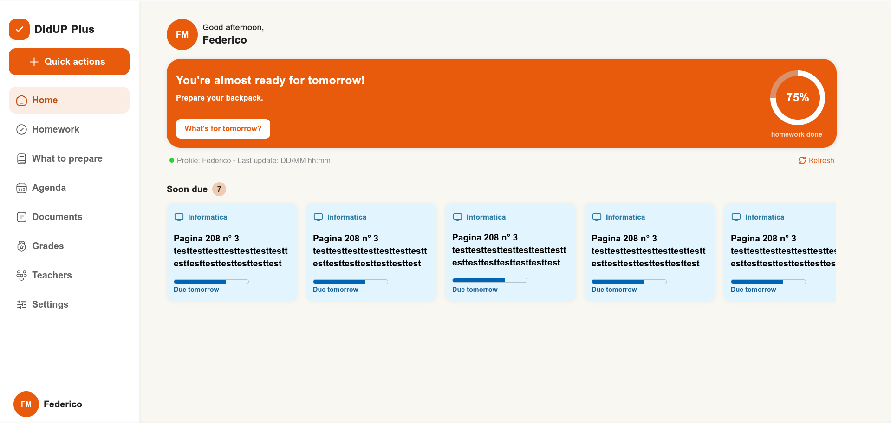

# DidUP Plus

A brand new way to organize your tasks and see your homework in a smart enviroment. It connects to the Argo servers and shows data in a simple and straightforward UI. It gets data from the most used school platform in italy: Argo DidUP
## Preview

## About the project

DidUP Plus is born from the need to organize school data in a clear way: DidUP is simple, but there's not much room for customization and quick overviews, so I am fixing that.
This is a recreation of a previous vibecoded project of mine, now made from scratch in HTML+CSS: it may seem stupid, but I am actually learning a lot about visual hierarchy and good UI.

Everything about this is powered by [Argo Proxy](github.com/fedevxyz/argoproxy), a Deno function that reverse engineers the Argo servers.

I'm also participating in Hack Club Terra, a YSWS (You Ship We Ship) program by Hack Club.

## Technologies

**Client:** HTML, CSS, Javascript

**Server:** Python or Deno

## Features (so far)
- Sidebar navigation between 8 screens
- Home: welcome header, "ready for tomorrow" widget, connection status, upcoming homework
- Homework: filters and homework cards with subject colours generated from the subject name
- What to prepare: tomorrow's timetable, backpack checklist, homework overview
- Agenda, Documents, Grades, Teachers and Settings are still placeholders

## Demo
You can try DidUP Plus by clicking [here](https://www.fedevxyz.github.io/didup-plus).
It uses sample and hand-written data to get an overview of the project, to use real data please wait until a later version with a backend is released.

### Disclaimer
1. This project is still in development, so it doesn't include any real "app" to it. It's just an HTML page with some CSS and Javascript. You cannot add assignments, sync it with Argo or any of those things.
    Now you probably are wondering: "**What can I do then?**". You can try the interface up until screen 3, and get an idea of the concept DidUP plus follows.
2. **For Terra Reviewers**: This project is not made by AI, but *it takes the design concept and ideas of a vibecoded project*. Just for clarity, you can visit the [vibecoded project](https://www.github.com/fedevxyz/didup-plus-vibecoded) and try a [demo](fedevxyz.github.io/didup-plus-vibecoded).
    And if you are still uncertain, i recieved permission to make this project by Olive on slack. You can visit the conversation [here](https://hackclub.slack.com/archives/C0B7KLPA03W/p1793819397760629?thread_ts=1793660295.215039&cid=C0B7KLPA03W) (it's the last three messages)

